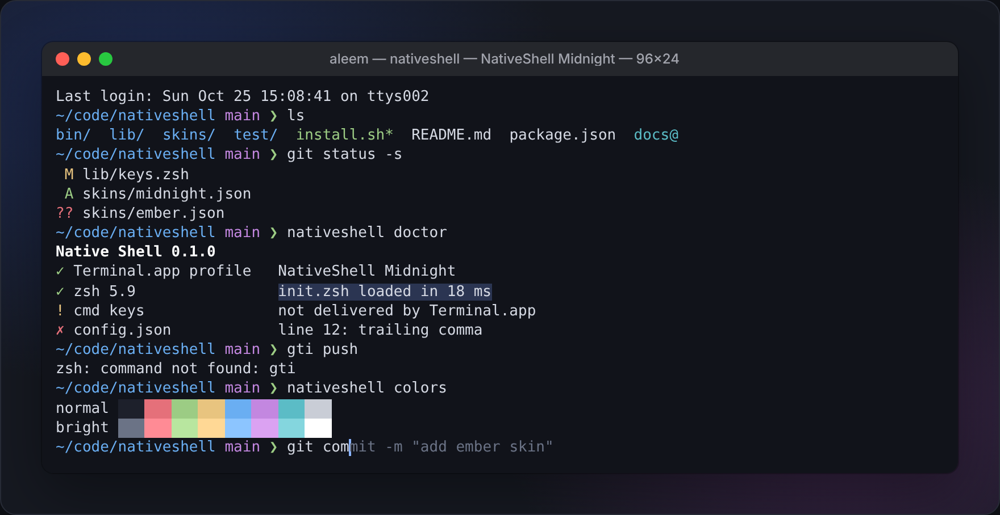
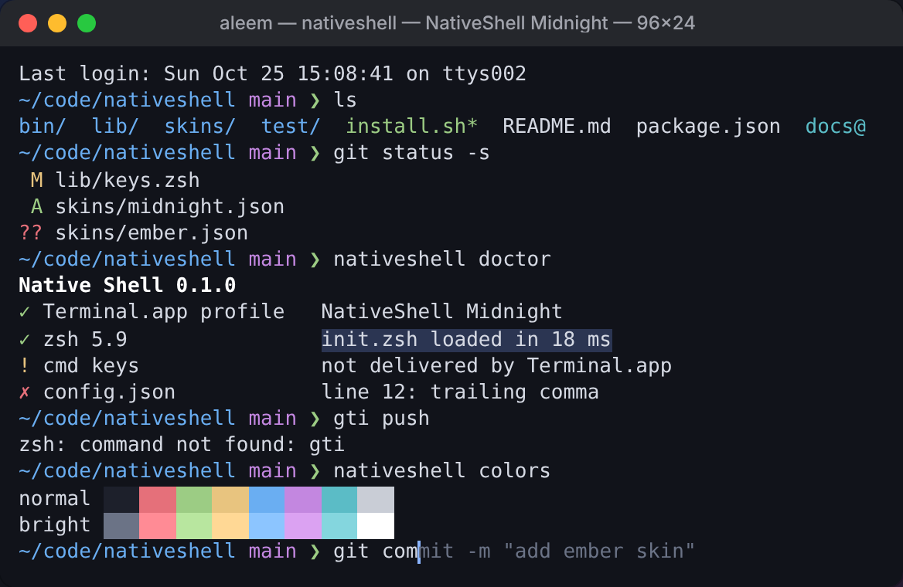
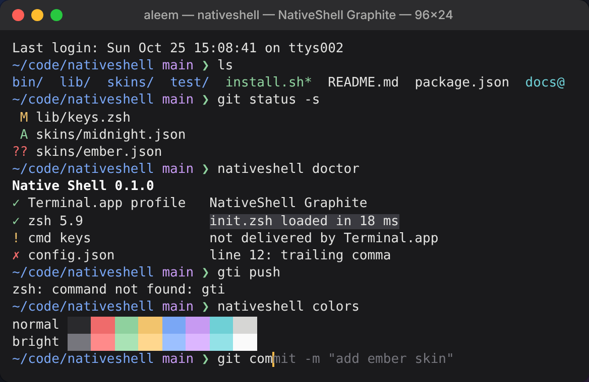
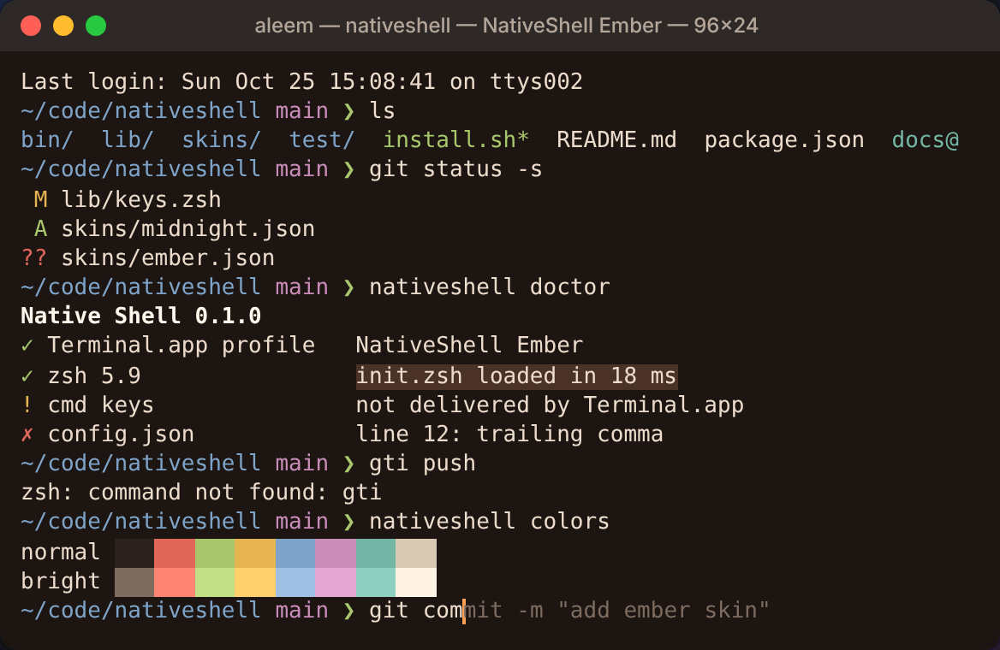
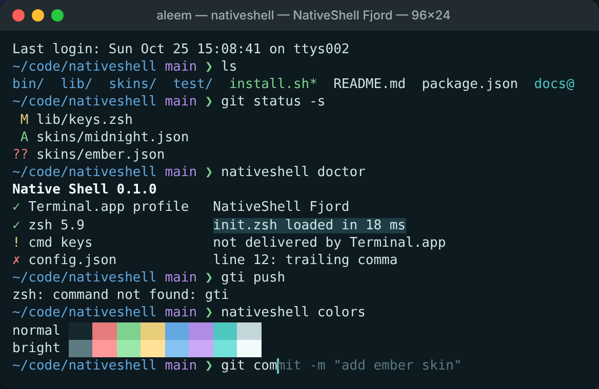
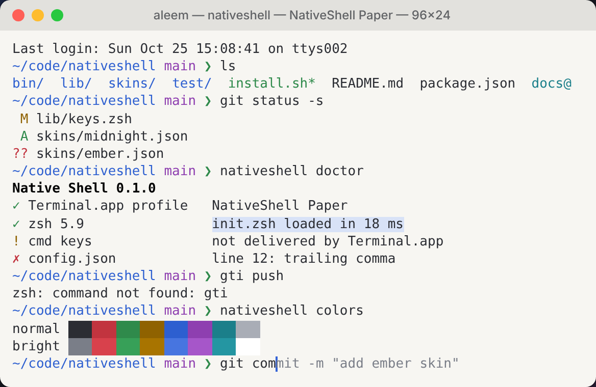

# Native Shell

**A lightweight skin for macOS Terminal.app.** ⌘ editing, Tab-to-accept suggestions, better history, a clean Git prompt and good-looking skins, without replacing your terminal.



Native Shell keeps you in the Terminal.app you already have. It installs a Terminal profile and a small set of Zsh settings. It runs no background process, has no runtime dependencies, and everything it changes can be undone.

> **Status:** early development (v0.x). Things will change. Feedback and issues are welcome.

---

## Install

```sh
npx nativeshell
```

No Node? Use either of these instead. All three run the same installer.

```sh
zsh <(curl -fsSL nativeshell.sh)
brew install aleem/tap/nativeshell && nativeshell setup
```

Setup will:
1. Back up your `~/.zshrc` and Terminal.app preferences
2. Ask you to pick a skin
3. Create `~/.config/nativeshell/`
4. Import the skin into Terminal.app and make it the default
5. Add **one** guarded line to `~/.zshrc`

Open a new Terminal window when it finishes. Node is only used for the install. After that, everything is plain Zsh.

---

## Skins

| Midnight (default) | Graphite |
|---|---|
|  |  |
| Dark, cool blue | Dark, neutral |

| Ember | Fjord |
|---|---|
|  |  |
| Dark, warm | Dark, teal |

| Paper |
|---|
|  |
| Light |

```sh
nativeshell skin            # list skins
nativeshell skin ember      # switch
```

**Make your own:** open the [Skin Studio](https://aleem.github.io/nativeshell/skin-studio.html), adjust colors, font, cursor and opacity with a live preview, then copy the JSON into `skins/<name>.json`.

---

## Features

**⌘ editing at the prompt**

| Shortcut | Action |
|---|---|
| `⌘ ←` / `⌘ →` | Start / end of line* |
| `⌘ ⌫` | Delete to start of line* |
| `⇧ ←` / `⇧ →` | Select a character at a time |
| `⇧⌘ ←` / `⇧⌘ →` | Select to start / end of line* |
| `⌥ ←` / `⌥ →` | Move by word |

\* Terminal.app doesn't pass ⌘ keys to the shell by default. Support for these is being tested; see [docs/feasibility.md](docs/feasibility.md).

**Shell**
- **Tab to accept:** as you type, a matching past command appears in grey. Tab fills it in; otherwise Tab completes as normal.
- Prefix history search with `↑` / `↓`, and history shared across tabs
- Optional minimal prompt with Git branch and status
- Optional short aliases for coding agents (Claude Code, Codex, Gemini CLI and others)

**Font size**
- Default is 13 pt, set per skin and overridable in `config.json`
- `⌘+` / `⌘−` / `⌘0` resize the current window (built into Terminal.app)
- `nativeshell font 14` or `nativeshell font +1` changes the default

---

## Configuration

Everything lives in `~/.config/nativeshell/config.json`:

```json
{
  "skin": "midnight",
  "font": { "name": "SF Mono", "size": 13 },
  "cursor": { "shape": "bar", "blink": true },
  "window": { "columns": 120, "rows": 34 },

  "features": {
    "cmdKeys": true,
    "shiftSelect": true,
    "tabSuggest": true,
    "historySearch": true,
    "prompt": "minimal"
  },

  "history": { "size": 50000, "shareAcrossTabs": true },
  "agents": { "cc": "claude", "cx": "codex" }
}
```

Settings here override the skin, so your font size and preferences survive skin changes.

```sh
nativeshell edit      # open config.json and apply when you close it
nativeshell apply     # re-apply (safe to run repeatedly)
```

---

## Commands

```sh
nativeshell                     # status: active skin and features
nativeshell skin <name>         # switch skin
nativeshell font <size|+1|-1>   # change default font size
nativeshell on|off <feature>    # e.g. nativeshell off tabSuggest
nativeshell edit                # edit config.json
nativeshell doctor              # diagnose problems
nativeshell uninstall           # restore backups and remove everything
```

---

## What it touches

| Location | Change |
|---|---|
| `~/.zshrc` | One line that loads `~/.config/nativeshell/init.zsh` (skipped safely if missing or broken) |
| `~/.config/nativeshell/` | Config, skins, Zsh files, the `nativeshell` command and backups |
| Terminal.app preferences | An imported Native Shell profile, set as the default |

No `sudo`. No background processes. No other files.

---

## Compatibility

- **macOS** with Terminal.app and Zsh (the default shell since Catalina)
- SSH, tmux, Vim, Nano and less keep working normally. Editing features only apply at the Zsh prompt.
- Designed to coexist with Oh My Zsh, Starship and Powerlevel10k (compatibility work in progress)

## Privacy

Your commands, history, environment variables and files are **never** sent anywhere. No telemetry. Core features need no network connection.

## Principles

- **Enhance the terminal you have, don't replace it.** No custom terminal engine or renderer.
- **Lightweight.** Target is under 50 ms added to shell startup, and nothing running in the background.
- **Safe by default.** Backups before every change, re-running never duplicates anything, and a broken config never breaks your shell.
- **Honest limits.** If Terminal.app can't do something reliably, we say so.

---

## Roadmap

- [ ] Installer with backup and restore
- [ ] Five starting skins and the Skin Studio
- [ ] Tab-to-accept suggestions and history search
- [ ] Shift-select and ⌘ editing (pending feasibility)
- [ ] Minimal Git prompt
- [ ] `doctor` diagnostics
- [ ] npm package, Homebrew tap and curl installer
- [ ] Adapters for other terminals (Ghostty, iTerm2)

## Uninstall

```sh
nativeshell uninstall
```

This restores your original `~/.zshrc` and Terminal.app preferences. If the command is missing, run `zsh ~/.config/nativeshell/bin/nativeshell uninstall`.

## Contributing

Issues and pull requests are welcome, especially new skins. Please include your macOS version and the output of `nativeshell doctor` when reporting bugs.

## License

